# agenteval-bench

**pytest for agent outputs.**


[](https://github.com/Zion-sewers/agenteval-bench/actions/workflows/ci.yml)
[](LICENSE)


You test code with pytest. You test agents with vibes. agenteval-bench closes that gap: define eval suites in YAML, score outputs with deterministic matchers, track regressions across runs, and fail CI when the pass rate drops below your threshold.

Its sharpest trick is `bugsmith`: point it at any small pytest repo and it builds you an executable SWE-benchmark. It injects seeded AST-mutation bugs, validates each one inside Docker against the repo's own test suite, and keeps only bugs that break at least one test — with `FAIL_TO_PASS` / `PASS_TO_PASS` lists. Benchmark correctness defined by the machine, never by hand-written task lists.

## 60 seconds

```bash
git clone https://github.com/Zion-sewers/agenteval-bench && cd agenteval-bench
uv venv && source .venv/bin/activate
uv pip install -e ".[dev]"
agenteval-bench run --suite examples/support-agent.yaml --ci --threshold 0.9
```

Exit 0: pass. Exit 2: the gate failed. Wire it into CI and agent regressions become red builds.

## How it works



Each eval suite rises to its pass rate against the dashed gate line. One suite below the gate is enough: the bar pulses red and the merge gate exits 2. The animation loops the verdict so the failure mode is unmissable.

## What it does

- Deterministic matchers: `exact`, `contains`, `regex`, `json_schema`. No model calls, no flakiness.
- Replay mode: grade recorded outputs without burning inference budget.
- Regression tracking: compare runs, see which cases moved.
- Python API: `EvalSuite.from_yaml` + `EvalRunner.run(suite, agent_fn)` for live agents.

## Honest limits

- The CLI replays recorded outputs. Live agent evaluation needs your own `agent_fn` through the Python API.
- LLM-as-judge is planned, not implemented.
- Bug-injection benchmarking needs Docker.
- v0.1.0, Alpha. The matchers are strict; the ecosystem is young.

---

Part of [Zion](https://github.com/Zion-sewers) — public infrastructure for trust in agents. The eval layer for the long-horizon era.
